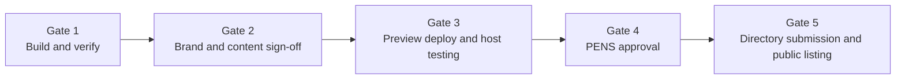

# Deployment checklist: PENS

Work moves through gates. A gate opens only when every item before it is checked. Items inside a gate can run in parallel.

## Gate 1: Build and verify

- [ ] `npm install`, `npm test`, `npm run build` and `npm run build:static` all pass.
- [ ] `tools/list` returns 9 tools, each with `_meta.ui.resourceUri` = `ui://pens/<name>.html` and all four annotation hints as explicit booleans.
- [ ] `resources/read` returns `text/html;profile=mcp-app` for every widget.
- [ ] `/mcp` and `/mcp/submission-d661e169` both answer `initialize` and `tools/list`.
- [ ] `/privacy`, `/terms`, `/support`, `/reviewer-demo`, `/preview` and `/healthz` load.
- [ ] `/` serves `site/index.html` when the splash site is present, and the fallback page when it is not.
- [ ] `chatgpt-app-submission.json` validates against the v1 schema (covered by `tests/submission.test.ts`).

## Gate 2: Brand and content sign-off

- [ ] **Official PENS logo dropped in:** replace `public/assets/pens-logo.svg`, regenerate the PNGs (`SHARP_DIR=… npm run brand:png`), and confirm pages, widgets and icons show it.
- [ ] **PENS clinician content sign-off:** a PENS clinician approves every clinical item in English and Spanish; items move from `clinicReview: "pending"` to `"approved"` in a PR naming the reviewer, and `tests/content.test.ts` switches to require `approved`.
- [ ] Every `TODO-verify` resolved with the PENS office (website deep links, healow practice URL, parking and floor, ISAP turnaround, referral process).
- [ ] PENS confirms the use of the name "PENS", the Pip character and the listing copy in `STORE_LISTING.md`.

## Gate 3: Preview deploy and host testing

- [ ] Deploy a Vercel preview (`vercel`), not production.
- [ ] In ChatGPT developer mode, connect `https://<preview-host>/mcp` and run every prompt on `/reviewer-demo` in English and Spanish; widgets render and match the expected results.
- [ ] In Claude, add the same URL as a custom connector and run the same prompts; widgets render through the MCP Apps bridge.
- [ ] Check the safety cases: emergency card first, no dosing advice, no PHI echoed, no result interpretation.
- [ ] Check reduced motion (OS setting) turns off widget animation.

## Gate 4: PENS approval

- [ ] **PENS approves the app before public listing**, in writing, after seeing the preview build.
- [ ] Privacy, terms and support pages reviewed by PENS; support routing (noeticactivity@gmail.com for the app, the PENS office for care) agreed.

## Gate 5: Directory submission and public listing

- [ ] Promote to production (`vercel --prod`) and confirm the production host answers on `/mcp/submission-d661e169`.
- [ ] Submit in the ChatGPT app directory with the MCP URL `https://<host>/mcp/submission-d661e169`, and import `chatgpt-app-submission.json`.
- [ ] Fill the remaining form fields from `STORE_LISTING.md`; upload the 512/1024 icons and screenshots.
- [ ] Keep the submission path stable for the life of the listing. Changing it means updating `src/config.ts`, `vercel.json`, this file and the submission.

## Environment

No environment variables or secrets are required. Optional: `PORT` (local dev, default 8787) and `PENS_SITE_DIR` (override the splash site folder).
