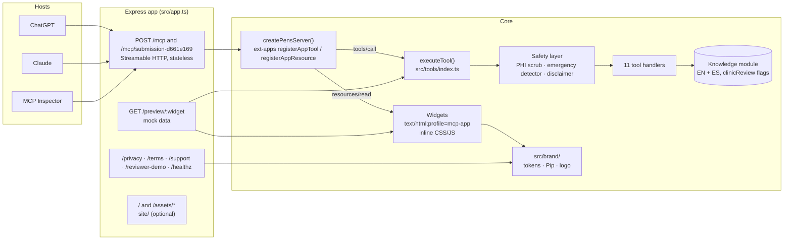
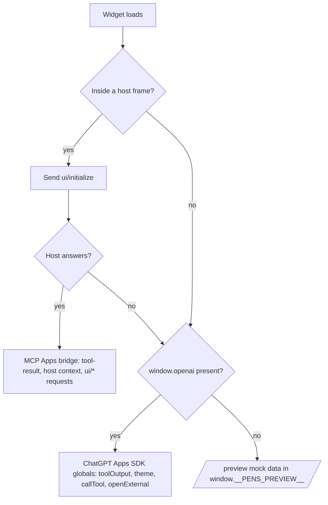

# PENS: MCP Apps server for ChatGPT and Claude

PENS brings **Pediatric Epilepsy & Neurology Specialists** (508 S. Habana Ave., Suite 340, Tampa, FL 33609 · (813) 873-7367 · [pensoftampabay.com](https://www.pensoftampabay.com/)) into ChatGPT and Claude for Tampa Bay families. PENS is operated by BinaryBros LLC on behalf of Pediatric Epilepsy & Neurology Specialists. App support: noeticactivity@gmail.com.

It follows the Sanctum Reflections house pattern: the **MCP Apps** standard (`@modelcontextprotocol/ext-apps` 1.7.5 + `@modelcontextprotocol/sdk` 1.32.x). Widgets are registered as `ui://pens/<name>.html` resources with mime type `text/html;profile=mcp-app`, so they render in **both ChatGPT and Claude**. ChatGPT Apps SDK `openai/*` metadata is kept for compatibility.

Everything is read-only, bilingual (English and Spanish) and stateless. The app collects **no PHI** and stores no data. All clinical content is flagged `clinicReview: "pending"` until PENS clinicians sign off.

## Tools

| Tool | What it does | Widget (`ui://pens/…`) |
|---|---|---|
| `clinic_info` | Hours (Mon–Thu 7:30 AM–5:00 PM, Fri 7:30 AM–4:30 PM), live open-now status (America/New_York), address, phone, fax, map | `clinic-card.html` |
| `find_care` | Matches a plain-language concern to PENS conditions and services, then gives the next step | `find-care.html` |
| `prepare_for_visit` | Checklist, what to bring, what to expect and a kid version for 6 visit types | `visit-prep.html` |
| `my_eeg_day` | Kids' (4–10) EEG story with **Pip**, a hold-still game and a breathing exercise | `eeg-adventure.html` (can request fullscreen) |
| `seizure_first_aid` | Stay / Safe / Side, what not to do, when to call 911, and a big seizure timer (amber at 4:00, pulsing call-911 at 5:00) | `seizure-first-aid.html` |
| `school_seizure_plan` | Florida CS/HB 1201 explainer, how to request an ISAP from PENS, caregiver-circle checklist | `school-plan.html` |
| `caregiver_quiz` | 5-question "Seizure-Ready" quiz with colorful tiles and a score | `caregiver-quiz.html` |
| `request_appointment` | Hands off to the official form and phone. Collects nothing | `appointment-handoff.html` |
| `for_pediatricians` | Referral fax and phone, what to include, urgent vs. routine guidance | `referral-card.html` |
| `meet_the_team` | Neutral team directory: round photos of PENS's 18 physicians, nurse practitioners and counselors (search, role and Speaks Spanish filters, profile sheet with focus, languages, suite and year joined) plus "Which suite?" for Suites 340, 240 (EEG) and 140. No ratings or rankings; scheduling goes through the office. Names, photos and bios need PENS approval before public listing (`src/content/team.ts`, all `clinicReview: "pending"`) | `team-directory.html` |

Every tool declares all four annotation hints as explicit booleans: `readOnlyHint: true`, `idempotentHint: true`, `destructiveHint: false`, `openWorldHint: false`. The written justifications are in [`chatgpt-app-submission.json`](chatgpt-app-submission.json). Every tool accepts an optional `lang` (`en` | `es`); without it the language comes from Spanish free text, then the host locale, then English.

## Endpoints

| Path | Purpose |
|---|---|
| `POST /mcp` | MCP Streamable HTTP endpoint (stateless, JSON responses) |
| `POST /mcp/submission-d661e169` | Stable, unlisted alias of `/mcp` for the ChatGPT app directory submission (constant `SUBMISSION_PATH` in `src/config.ts`, rewrite in `vercel.json`) |
| `GET /` and `/assets/*` | Splash site from `site/` (built separately). Falls back to a built-in home page when `site/` is missing. Brand files (`pens-logo.svg`, `pens-logo-512.png`, `pens-logo-1024.png`) always come from `public/assets/` |
| `GET /preview`, `/preview/:widget` | Widgets in a plain browser with mock data from the real tool handlers |
| `GET /privacy`, `/terms`, `/support`, `/reviewer-demo` | Policy, support and reviewer pages (EN + ES), each with a "Preview" badge |
| `GET /healthz` | Health check |

## Architecture



How a tool call reaches a widget:

```mermaid
sequenceDiagram
  participant H as Host (ChatGPT or Claude)
  participant S as /mcp
  participant G as Safety layer
  participant T as Tool handler
  participant W as Widget iframe
  H->>S: tools/list (tool _meta.ui.resourceUri = ui://pens/<name>.html)
  H->>S: resources/read ui://pens/<name>.html
  S-->>H: text/html;profile=mcp-app + _meta.ui.csp (resourceDomains: only PUBLIC_ORIGIN, for the intro clip)
  H->>S: tools/call {name, arguments}
  S->>G: strict schema, then guardInput(args)
  G->>T: cleaned args + lang
  T-->>S: structured data + summary text
  S-->>H: structuredContent, content[text], _meta
  W->>H: ui/initialize
  H-->>W: hostContext (theme, locale, display modes)
  H->>W: ui/notifications/tool-result
  W->>H: ui/open-link · ui/message · ui/request-display-mode · tools/call
```

The widget runtime (`src/widgets/shared.ts`) picks its host in this order:



## Brand

One module, `src/brand/index.ts`, holds the tokens, the Pip drawing and the logo loader. Pages, widgets, `/preview` and the PNG script all read from it.

| Token | Value | Use |
|---|---|---|
| teal | `#0F6E74` | Primary, headings, buttons |
| sunshine | `#F6B93B` | Accent, focus ring, Pip |
| coral | `#F2765A` | Decorative only (Pip's cheeks and antenna tip) |
| brick | `#B83A26` | Urgent / call 911 (white text) |
| sky | `#E8F4F6` | Chips, soft panels |
| ink | `#1D2B36` | Text |
| page | `#F4F6F7` | Page background |

Headings use Fredoka: widgets embed Fredoka SemiBold (600, Basic Latin + Latin-1, ~15 KB WOFF2, ~20 KB as base64) as a data: URI in the shared CSS, because hosts block font fetches. Rebuild it with `scripts/subset-fredoka.sh` (fonttools + brotli); the SIL Open Font License is in `src/brand/fonts/Fredoka-OFL.txt`. Body text uses Nunito when installed, then the system rounded stack.

**Pip** is the PENS helper: a round sunshine-yellow character with a wavy teal antenna tipped with a coral dot, big ink eyes with white highlights, rosy coral cheeks and a smile. It is drawn as inline SVG by `pipSvg()`.

**Logo.** The logo is one swappable file, `public/assets/pens-logo.svg`. Pages link to `/assets/pens-logo.svg`; widgets inline the same file as a data URI. The current file is a placeholder (rounded teal tile, sunshine EEG wave, "PENS" wordmark). To use the official PENS logo:

1. Replace `public/assets/pens-logo.svg` with the official SVG.
2. Regenerate the 512 and 1024 px PNGs: `npm i --prefix /tmp/pens-brand-tools sharp && SHARP_DIR=/tmp/pens-brand-tools npm run brand:png`.
3. Run `npm test`.

**Motion.** `src/widgets/shared.ts` has a small motion kit on `window.PENS` (also `PENS.motion`), in vanilla CSS/JS that runs under the widgets' CSP: `fadeUp(els)` (IntersectionObserver, staggered), `springPop(el, {enter})`, `shake(el)`, `sparkle(el)` (star glints, ~600 ms), `confetti(el)`, `typewriter(el, text, msPerChar)` (capped at ~600 ms; screen readers get the full text once from an sr-only copy, and the untyped rest keeps its space so nothing reflows), `countUp(el, to)`, `ring({...})` (animated circular progress ring after Magic UI's, with a gauge arc, a gapped track arc and a counting center label) and `tickBox()` (a checkbox face whose tick draws itself). Every helper renders the final state at once under `prefers-reduced-motion`, never moves focus and never blocks input.

| Card | Motion |
|---|---|
| question-card | Rows fade up staggered; picking pops the box and draws the tick; the picked count counts and pops; "Show my card" springs in with sparkles; pass-the-phone is a 3D flip with the other language fading in underneath |
| visit-prep | Progress ring fills as items are checked; ticks draw; sparkles and "All set!" when complete |
| eeg-adventure | Pip bounces in; EEG stickers pop onto Pip's head with a squash (sticker hat until the last scene); scene text types in; the hold-still star sparkles; breathing is one smooth 8 s scale loop; confetti on the last scene |
| seizure-first-aid | Calm: gentle fade-ups only; a ring sweeps toward 5:00 around the clock (amber at 4:00, brick at 5:00), then a slow brick pulse and the Call 911 button pops in. No sparkles, confetti or typing |
| caregiver-quiz | Tiles pop in and press-bounce; a right answer pops green with sparkles; a wrong one shakes softly; the explanation types in; the score ring sweeps while the score counts up |
| find-care, clinic-card, appointment-handoff, referral-card, school-plan | Headline types in; cards and rows fade up staggered; buttons pop as they land. Clinic card: breathing dot on "Open now". School plan: checkmarks pop and "N ready" counts up |

**First-run intro.** The first time someone opens a PENS card (any card but seizure first aid, and never with an emergency card or under reduced motion), a 3.2 s sped-up clip of the blocks tumbling into the PENS logo plays muted and inline with a Skip button, then the card springs in. "Once" is a `pensIntro` flag in widget state plus `localStorage` when allowed, else once per page load; if the clip does not start within ~4 s the card shows anyway. The clip (`public/assets/intro.mp4` H.264 faststart, `intro.webm` VP9, `intro-poster.jpg`) is loaded by absolute URL from `PUBLIC_ORIGIN` (`src/config.ts`, env `PUBLIC_ORIGIN`, default `https://pens-family-guide.vercel.app`), which is the only origin in the widgets' CSP (`resourceDomains` / `resource_domains`). The clinic card footer has "Replay intro". `/guide` plays the same intro once per visit (sessionStorage) and opens cards with `?intro=off`. Pip also bobs, blinks and sways its antenna.

## Project layout

| Path | Contents |
|---|---|
| `src/app.ts` | Express app: MCP endpoints, previews, pages, splash site and assets |
| `src/server.ts` | `createPensServer()`: 11 tools + 11 UI resources via ext-apps |
| `src/config.ts` | App name, operator, support email, `SUBMISSION_PATH`, clinic contact |
| `src/brand/` | Tokens, fonts, Pip SVG, logo loader |
| `src/pages.ts` | Privacy, terms, support, reviewer demo, fallback home |
| `src/reviewer.ts` | Reviewer prompts and expected results (EN + ES), shared with the submission file |
| `src/content/` | Typed EN + ES knowledge module with `clinicReview` flags |
| `src/safety/` | Emergency detector, PHI scrubber, safety envelope |
| `src/tools/` | One file per tool; `index.ts` holds `executeTool`, annotations and `_meta` |
| `src/widgets/` | `shared.ts` (CSS + runtime bridge) and one file per widget |
| `public/assets/` | `pens-logo.svg` (swappable) and its 512/1024 PNGs; `team/*.jpg` full-size provider photos (inlined into the widget as 160 px WebP by `npm run team:photos`, which writes `src/content/teamPhotos.ts`; needs sharp via `SHARP_DIR`) |
| `scripts/render-logo.mjs` | Renders the logo PNGs with sharp (installed outside the project) |
| `scripts/prepare-static.mjs` | Builds `static-build/` for Vercel from `site/index.html`, `site/assets/` and `public/assets/` |
| `site/` | Splash site, owned by a separate build. This repo never writes there |
| `api/index.mjs` | Vercel function entry (exports the Express app from `dist/app.js`) |
| `chatgpt-app-submission.json` | ChatGPT app submission import file (schema v1) |
| `STORE_LISTING.md`, `DEPLOYMENT_CHECKLIST.md` | Listing copy and release gates |
| `tests/` | vitest: registration, annotations, submission, bridge, brand, site serving, tools, safety, content, widgets |

## Run it

Requires Node 20 or later.

```bash
npm install
npm test          # vitest
npm run build     # tsc -> dist/
npm run dev       # tsx watch, http://localhost:8787 (set PORT to change)
npm start         # run the built server from dist/
```

Smoke test:

```bash
curl -s -X POST http://localhost:8787/mcp \
  -H 'Content-Type: application/json' -H 'Accept: application/json, text/event-stream' \
  -d '{"jsonrpc":"2.0","id":1,"method":"tools/list","params":{}}'
```

Widget previews: `http://localhost:8787/preview`, for example `/preview/find-care?concern=migraines&lang=es&theme=dark` or `/preview/eeg-adventure?display=fullscreen`.

## Test with MCP Inspector

```bash
npm run dev
npx @modelcontextprotocol/inspector
```

Choose transport **Streamable HTTP**, enter `http://localhost:8787/mcp`, connect, list the tools, call `find_care` with `{"concern":"my son has staring spells"}`, and read the resource `ui://pens/find-care.html`.

## Add to ChatGPT (developer mode)

1. Expose the server over HTTPS (for example `cloudflared tunnel --url http://localhost:8787`) or deploy it.
2. In ChatGPT, turn on developer mode under Settings, Apps & Connectors, Advanced.
3. Create a connector with `https://<your-host>/mcp` and no authentication. For the directory submission use `https://<your-host>/mcp/submission-d661e169`.
4. Try the prompts on `/reviewer-demo`. Refresh the connector after changing tool metadata.

## Add to Claude (custom connector)

1. In Claude, open Settings, Connectors, Add custom connector, and paste `https://<your-host>/mcp`. No auth is needed.
2. Claude renders the same MCP Apps widgets through the `ui/*` bridge.

## Deploy (Vercel)

- `vercel.json` runs `npm run build:vercel`: `tsc`, then `scripts/prepare-static.mjs`, which writes `static-build/` (the `outputDirectory`).
- Vercel's CDN serves `/` from `site/index.html` and `/assets/*` from `site/assets/`, with `public/assets/` (the swappable logo and its PNGs) overriding same-named files so one logo file drives the app and the site.
- Everything else, including `/mcp`, `/mcp/submission-d661e169`, `/preview`, the policy pages, `/healthz`, and `/` when there is no site, is rewritten to `api/index.mjs` (the Express app). The function bundles `dist/`, `public/` and `site/`.

Release gates are in [`DEPLOYMENT_CHECKLIST.md`](DEPLOYMENT_CHECKLIST.md).

## Safety layer (`src/safety/`)

- **Emergency detector (EN and ES).** Runs on every free-text argument: seizure 5 minutes or longer, back-to-back seizures, a seizure happening now, not breathing, blue lips, first seizure, head injury, won't wake, seizure in water, ingestion, and self-harm. When it fires, `structuredContent.emergency` holds an urgent card with **Call 911** first, and the text reply starts with the 911 message.
- **No PHI.** Input schemas are strict (`additionalProperties: false`) with no fields for names, birthdates, MRNs or contact details. Free text is scrubbed before use, tools never echo user text, and a bilingual privacy notice appears when something was removed.
- **No medical advice.** Every result carries a bilingual disclaimer, and the server `instructions` tell the model not to diagnose or advise on dosing.

## Content review process

1. All clinical content lives in `src/content/`; each clinical item has `clinicReview: "pending"`.
2. A PENS clinician reviews both languages for each item, preferably with a native Spanish speaker, in `src/content/*.ts` or at `/preview?lang=en|es`.
3. Approved items change to `clinicReview: "approved"` in a PR that names the reviewer.
4. `tests/content.test.ts` requires every item to stay `pending` until sign-off (the launch gate); after sign-off, switch it to require `approved`. Until then every widget shows a pending-review chip.
5. Resolve every `TODO-verify` (`grep -rn "TODO-verify" src/`) before public listing.
